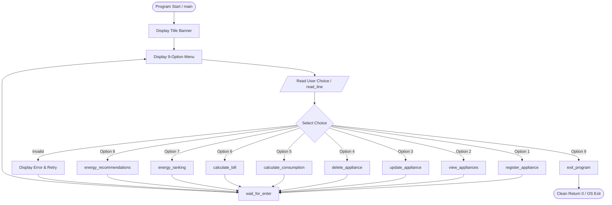

# WattWise — Technical and Beginner-Friendly Code Documentation

This document provides a comprehensive technical reference and beginner-friendly guide for the **WattWise** Household Electricity Consumption Tracker written in **NASM x86-64 Assembly Language**.

It is specifically structured to support student laboratory presentations, code walkthroughs, and defense interrogations.

---

## 1. Program Architecture and Overview

WattWise is an x86-64 console application that operates entirely in memory using a fixed-record database model. It integrates nine core features:



---

## 2. Memory Organization and Data Structures

### 2.1 The 72-Byte Appliance Record Structure
Each appliance record occupies exactly **72 contiguous bytes** in memory. This fixed-size layout eliminates dynamic memory allocation and pointer dereferencing complexity.

| Field Offset | Field Name | Size | Data Type | Assembly Representation | Description |
|---|---|---|---|---|---|
| `+0` | `id` | 8 bytes | Unsigned 64-bit integer | `dq` (QWORD) | Unique sequential ID (1, 2, 3...) |
| `+8` | `name` | 32 bytes | ASCII string (null-terminated) | `resb 32` | Appliance name (max 31 chars + `\0`) |
| `+40` | `wattage` | 8 bytes | Unsigned 64-bit integer | `dq` (QWORD) | Power rating in Watts (1 – 100,000 W) |
| `+48` | `hours` | 8 bytes | Unsigned 64-bit integer | `dq` (QWORD) | Daily operating hours (1 – 24 hrs) |
| `+56` | `reserved` | 16 bytes | Zero padding | `resb 16` | 16-byte alignment and future flags |

### 2.2 Array Storage in `.bss` and State Variables in `.data`
```nasm
section .data
    appliance_count dq 0            ; Current number of stored appliances (0 to 20)
    next_id         dq 1            ; Auto-increment counter for appliance IDs

section .bss
    appliance_table resb 1440       ; 20 records * 72 bytes = 1440 bytes
    line_buf        resb 128        ; General-purpose line input buffer
    temp_name       resb 32         ; Temporary string buffer for names
    rank_indices    resq 20         ; Temporary index array for selection sort
    rank_kwh        resq 20         ; Temporary consumption array for sorting
```

---

## 3. Major Procedures Documentation

---

### Procedure: `main`

**Purpose:**
Initializes the runtime environment, displays the main menu in a loop, routes user choices to the corresponding feature procedures, and exits gracefully upon request.

**Technical Explanation:**
- Establishes the stack frame by saving the caller's frame pointer (`push rbp; mov rbp, rsp`).
- Allocates 48 bytes on the stack (`sub rsp, 48`), providing 32 bytes of shadow space for the Microsoft x64 calling convention plus 16 bytes for local alignment.
- Calls `display_menu` followed by `read_line` to capture user input into `line_buf`.
- Checks for EOF (returns `-1` in `RAX`); if detected, it branches to clean termination.
- Inspects the first byte of `line_buf` (`movzx eax, byte [rsi]`) and ensures only a single character was entered (`cmp byte [rsi + 1], 0`).
- Employs a branch ladder (`cmp al, '1' ... je .opt1`) to jump to the selected handler.
- If invalid, prints an error message, invokes `wait_for_enter`, and loops back.
- Upon option 9, it restores the stack frame (`mov rsp, rbp; pop rbp`) and returns `0` in `EAX`.

**Simple Explanation:**
This is the front door and control tower of the program. It shows the menu, waits for you to pick an option from 1 to 9, runs the code you chose, and waits for you to press Enter before showing the menu again.

**Important Instructions Used:**
- `push`, `pop`, `mov`: Setup and dismantle stack frame.
- `sub rsp, 48`: Allocates ABI shadow space and stack alignment.
- `cmp`, `je`, `jne`: Compare menu input character and branch.
- `call`: Transfers control to subroutines.
- `ret`: Returns control back to the operating system runtime.

**Example:**
The user types `5` and presses Enter. `main` checks that `al == '5'`, branches to `.opt5`, invokes `calculate_consumption`, then calls `wait_for_enter`, and resumes the menu loop.

---

### Procedure: `read_line`

**Purpose:**
Safely reads a complete line of text from standard input, strips carriage returns (`\r`), detects newlines (`\n`), prevents buffer overflows, and trims trailing whitespace.

**Technical Explanation:**
- Preserves non-volatile registers `RBX`, `RDI`, and `RSI`.
- Points `RDI` to `line_buf` and initializes the counter `EBX = 0`.
- Executes `.rl_loop` repeatedly calling C runtime `getchar`.
- Checks for EOF (`eax == -1`). If EOF is encountered when `ebx == 0`, it returns `RAX = -1` to notify the caller of stream termination.
- Ignores carriage return `\r` (ASCII 13) for cross-platform Windows/DOS compatibility.
- Breaks upon newline `\n` (ASCII 10).
- Implements buffer bound enforcement (`cmp ebx, 126; jge .rl_loop`), discarding any overflowing characters without writing past the allocated 128-byte buffer.
- Null-terminates the string at `line_buf[ebx]`.
- Implements a backward scan (`.trim_trailing`) that converts trailing spaces and tabs into null terminators.
- Returns the trimmed string length in `RAX`.

**Simple Explanation:**
Instead of risky functions that might crash if someone types too many letters, `read_line` reads input one letter at a time until you press Enter. It cleans off invisible Enter symbols, removes unnecessary trailing spaces, and guarantees the string won't overflow memory.

**Important Instructions Used:**
- `getchar`: C library call to read next input byte.
- `cmp eax, 10`: Checks for newline character.
- `mov byte [rdi + rbx], al`: Stores character into buffer.
- `test ebx, ebx`: Tests if string is empty.

**Example:**
User enters `"  Electric Fan   \n"`. `read_line` stores `"  Electric Fan"` and trims the trailing spaces, leaving a clean null-terminated string of length 14.

---

### Procedure: `parse_uint`

**Purpose:**
Converts an ASCII numeric string into an unsigned 64-bit integer, strictly validating that all characters are digits.

**Technical Explanation:**
- Accepts a pointer to the input string in `RCX`.
- Skips any leading space or tab characters.
- Validates that the string is not empty; if empty, exits with error flag `RDX = 1`.
- Iterates through characters: verifies `'0' <= char <= '9'`. If any non-digit character is encountered, exits immediately with `RDX = 1`.
- Performs integer accumulation: `imul rax, 10`, subtracts `'0'` from character, and adds to `RAX`.
- Detects overflow if the number exceeds register bounds.
- Upon success, returns the parsed 64-bit integer in `RAX` and sets `RDX = 0`.

**Simple Explanation:**
This procedure reads a word like `"150"` and turns it into the actual computer number `150`. If the user typed letters like `"abc"` or negative numbers like `"-5"`, it flags it as an error so the program doesn't calculate with bad data.

**Important Instructions Used:**
- `imul rax, 10`: Multiplies the running total by 10 (base-10 shifting).
- `sub dl, '0'`: Converts ASCII character code to numeric value (e.g. `'7'` (55) - 48 = 7).
- `jb`, `ja`: Unsigned conditional jumps detecting non-digit ASCII values.

**Example:**
Input string `"75"`. Step 1: char `'7'`, `rax = 7`. Step 2: char `'5'`, `rax = 7 * 10 + 5 = 75`. String ends; returns `RAX = 75`, `RDX = 0`.

---

### Procedure: `parse_rate_fixed_point`

**Purpose:**
Parses a decimal or integer electricity tariff string (e.g. `"12"`, `"12.00"`, `"11.85"`) into an integer scaled by 100 (centavos/hundredths).

**Technical Explanation:**
- Receives the string pointer in `RCX`.
- Separates parsing into whole part and fractional part:
  - While characters are before `.` (dot), multiplies whole part by 10 and adds digit.
  - Upon encountering `.`, sets the `saw_dot` flag in `R8D`. If a second dot appears, triggers an error.
  - First fractional digit represents tenths: multiplies by 10 and stores in `EBX`.
  - Second fractional digit represents hundredths: adds directly to `EBX`.
  - Subsequent decimal digits are ignored (truncated to 2 decimal places).
- Multiplies whole part by 100 (`imul rax, 100`) and adds fractional part (`add rax, rbx`).
- Validates that the resulting scaled rate is greater than 0 (`test rax, rax; jle .p_err`).
- Returns the hundredths value in `RAX` and error status in `RDX` (`0` = success, `1` = error).

**Simple Explanation:**
Since assembly language doesn't natively do decimal points without complex floating-point registers, this procedure converts a peso rate like `11.85` into `1185 centavos`. This allows all money math to stay fast, simple, and 100% accurate using whole-number math.

**Important Instructions Used:**
- `cmp dl, '.'`: Identifies the decimal point separator.
- `imul rax, 100`: Scales the whole peso part into hundredths.
- `add rax, rbx`: Combines whole centavos with fractional centavos.

**Example:**
Input `"12.5"`. Whole part = 12, fractional part = 50. Total returned in `RAX` = $12 \times 100 + 50 = 1250$ hundredths.

---

### Procedure: `register_appliance`

**Purpose:**
Prompts the user for appliance details (Name, Wattage, Operating Hours), validates each input against defined constraints, assigns a sequential unique ID, and stores the record in memory.

**Technical Explanation:**
- Checks array capacity (`mov rax, [appliance_count]; cmp rax, 20`). If full, prints error and exits.
- **Name Validation:** Calls `read_line`. If length is 0, prints `[!] Error: Appliance name cannot be blank.` and reprompts. Copies up to 31 characters into `temp_name` and null-terminates.
- **Wattage Validation:** Calls `parse_uint`. Checks `1 <= wattage <= 100,000`. Reprompts if non-numeric or out of range. Stores validated wattage in callee-saved `R12`.
- **Hours Validation:** Calls `parse_uint`. Checks `1 <= hours <= 24`. Reprompts if out of range. Stores in `R13`.
- **Record Placement:** Computes base offset: `offset = appliance_count * 72`.
- Loads destination address using RIP-relative addressing: `lea rdi, [appliance_table]; add rdi, r14`.
- Assigns unique ID from `next_id`, then increments `next_id`.
- Copies name bytes into `[rdi + 8]`. Writes wattage into `[rdi + 40]` and hours into `[rdi + 48]`. Zeroes the 16 reserved bytes.
- Increments `appliance_count`.
- Prints confirmation message displaying appliance name and assigned ID.

**Simple Explanation:**
This adds a new appliance. It asks for the name, wattage, and how many hours a day it runs. It checks every answer to make sure you didn't leave the name blank, enter 0 watts, or enter 25 hours in a day. Once everything is valid, it saves the appliance into the next empty slot in memory and gives it an ID number.

**Important Instructions Used:**
- `imul r14, RECORD_SIZE`: Multiplies record index by 72 bytes.
- `lea rdi, [appliance_table]`: Loads table base address.
- `lodsb`, `stosb`: String copy primitives.
- `inc qword [appliance_count]`: Updates total count of stored records.

**Example:**
User registers `"Electric Fan"`, `75W`, `8h`. The procedure stores ID #1 at byte 0, name at byte 8, 75 at byte 40, 8 at byte 48, and sets `appliance_count = 1`.

---

### Procedure: `view_appliances`

**Purpose:**
Displays all registered household appliances in a tabular ASCII format.

**Technical Explanation:**
- Checks `appliance_count`. If zero, prints `str_empty_db` notice and exits.
- Outputs table header (`tbl_view_hdr`) defining columns: `ID`, `Appliance Name`, `Wattage (W)`, `Daily Hours (h)`.
- Enters loop using `RBX` as loop index from `0` to `appliance_count - 1`.
- For each record, calculates address: `rax = rbx * 72`, `lea rsi, [appliance_table]; add rsi, rax`.
- Sets up arguments according to Microsoft x64 ABI:
  - `RCX`: format string pointer (`tbl_view_row`).
  - `RDX`: Appliance ID (`[rsi + OFFSET_ID]`).
  - `R8`: Name string pointer (`rsi + OFFSET_NAME`).
  - `R9`: Wattage (`[rsi + OFFSET_WATT]`).
  - Stack `[rsp + 32]`: Hours (`[rsi + OFFSET_HOURS]`).
- Calls `printf` to display the formatted row.
- Increments `RBX` and repeats until all records are printed.
- Prints table footer showing total count.

**Simple Explanation:**
Draws a table on the terminal showing every appliance currently saved in memory, displaying its ID number, name, wattage, and daily hours.

**Important Instructions Used:**
- `imul rax, RECORD_SIZE`: Computes array index offset.
- `mov [rsp + 32], rax`: Passes 5th parameter on stack as required by Windows 64-bit ABI.
- `call printf`: Outputs formatted table line.

---

### Procedure: `update_appliance`

**Purpose:**
Searches for an appliance by ID, displays its current settings, prompts for replacement values with full validation, and updates the record in-place.

**Technical Explanation:**
- Verifies database is not empty.
- Prompts for target Appliance ID and parses with `parse_uint`.
- Calls `find_appliance_by_id`. If not found (`RDI == 0`), outputs error and exits.
- If found, `RDI` holds pointer to the 72-byte record.
- Displays current Name, Power, and Hours using `printf`.
- Sequentially prompts and validates new Name, new Wattage (1..100,000 W), and new Hours (1..24 h).
- Writes new values directly into the existing record offsets without changing the ID.
- Displays update success confirmation message.

**Simple Explanation:**
Allows the user to change the details of an appliance already in the system. You type the ID of the appliance you want to change, and the program shows you what it's currently set to, then lets you enter new values.

**Important Instructions Used:**
- `call find_appliance_by_id`: Locates target record in memory.
- `mov [r14 + OFFSET_WATT], rax`: Writes new wattage into record memory.
- `mov [r14 + OFFSET_HOURS], rax`: Writes new operating hours into record memory.

---

### Procedure: `delete_appliance`

**Purpose:**
Removes an appliance by ID and shifts all subsequent records down by 72 bytes to preserve array contiguity without leaving memory gaps.

**Technical Explanation:**
- Prompts for ID and calls `find_appliance_by_id`.
- If not found, prints error message.
- If found, `R13` holds index $k$ of the record to delete.
- Saves the deleted appliance name into `temp_name` for the confirmation message.
- **Memory Shifting Loop (`.shift_loop`):**
  - Loop variable `RBX` starts at $k$.
  - Source index = $k + 1$, destination index = $k$.
  - Calculates destination pointer: `rdi = appliance_table + (rbx * 72)`.
  - Calculates source pointer: `rsi = appliance_table + ((rbx + 1) * 72)`.
  - Uses `mov ecx, RECORD_SIZE` and `rep movsb` to copy all 72 bytes of the next record into the current record's slot.
  - Increments `RBX` and continues until `(rbx + 1) == appliance_count`.
- Decrements `appliance_count` by 1 (`dec qword [appliance_count]`).
- Prints confirmation message.

**Simple Explanation:**
Deletes an appliance from memory. To prevent empty holes in the list, every appliance stored after the deleted one is shifted up one position, just like people in a queue stepping forward when someone leaves the line.

**Important Instructions Used:**
- `rep movsb`: Fast hardware-assisted block memory transfer of 72 bytes.
- `dec qword [appliance_count]`: Decrements record counter.

---

### Procedure: `calculate_consumption`

**Purpose:**
Calculates daily and monthly electricity consumption in kilowatt-hours (kWh) for every appliance and outputs a formatted summary table with household totals.

**Technical Explanation:**
- Formula implemented:
  $$\text{Daily hundredths} = \frac{\text{Wattage} \times \text{Hours}}{10}$$
  $$\text{Monthly hundredths} = \text{Daily hundredths} \times 30$$
- Accumulates `r14 = total_daily` and `r15 = total_monthly`.
- Formats each value into whole and fractional parts by dividing by 100:
  - `div r10` ($r10 = 100$): Quotient in `RAX` = whole kWh, Remainder in `RDX` = fractional hundredths.
- Passes parameters to `printf`:
  - `RCX`: format string (`tbl_cons_row`).
  - `RDX`: ID.
  - `R8`: Name.
  - `R9`: Daily whole kWh.
  - Stack `[rsp + 32]`: Daily fractional hundredths (`%02lld`).
  - Stack `[rsp + 40]`: Monthly whole kWh.
  - Stack `[rsp + 48]`: Monthly fractional hundredths (`%02lld`).
- At loop completion, divides totals and prints the summary footer.

**Simple Explanation:**
Computes how much energy each appliance uses. A 75-watt fan running 8 hours uses $75 \times 8 = 600$ watt-hours, which equals 0.60 kWh per day and 18.00 kWh per month. It displays all appliances and adds them up into a household total.

**Important Instructions Used:**
- `imul rax, [rsi + OFFSET_HOURS]`: Multiplies Watts by Hours.
- `div r10`: Unsigned integer division producing quotient (whole) and remainder (fraction).

---

### Procedure: `calculate_bill`

**Purpose:**
Prompts user for an electricity tariff rate in PHP/kWh, calculates the monthly cost for each appliance, and outputs an itemized bill with grand total.

**Technical Explanation:**
- Prompts for rate and parses into hundredths via `parse_rate_fixed_point` (e.g. `PHP 12.00` $\rightarrow$ `1200`).
- Iterates through appliances:
  - Computes `monthly_kwh_hundredths = ((Watts * Hours) / 10) * 30`.
  - Computes `cost_centavos = (monthly_kwh_hundredths * rate_hundredths) / 100`.
  - Adds to `total_cost_centavos` in `R14`.
  - Separates monthly kWh and cost into whole and fractional parts.
  - Prints table row using `printf`.
- Displays total estimated monthly bill in `PHP XX.YY` format.

**Simple Explanation:**
Estimates your monthly electric bill. You enter your electricity rate (like 12.00 pesos per kWh), and it multiplies that rate by each appliance's monthly energy use to show how much each appliance adds to your bill.

**Important Instructions Used:**
- `imul rax, r12`: Multiplies monthly kWh by electricity rate.
- `div r10`: Divides by 100 to normalize fixed-point scaling.

---

### Procedure: `energy_ranking`

**Purpose:**
Ranks all registered appliances in descending order of energy consumption using Selection Sort and displays their relative percentage share of total household energy.

**Technical Explanation:**
- Computes monthly kWh for all appliances, copying their indices into `rank_indices[0..n-1]` and consumption into `rank_kwh[0..n-1]`.
- Accumulates `r14 = total_household_kwh`.
- **Selection Sort Algorithm:**
  - Outer loop `i` from `0` to `n - 2`.
  - Inner loop `j` from `i + 1` to `n - 1`. Finds index of maximum consumption.
  - Swaps both `rank_kwh` and `rank_indices` so the original records remain intact in `appliance_table`.
- **Percentage Calculation:**
  $$\text{Share percentage hundredths} = \frac{\text{device\_kwh} \times 10000}{\text{total\_household\_kwh}}$$
- Loops through sorted indices and prints rank `#1`, `#2`, `#3`, etc.
- Explicitly reloads `lea r10, [rank_indices]` and `lea r11, [rank_kwh]` inside the loop to guard against C library volatile register corruption.
- Highlights the #1 highest energy-consuming appliance in a banner below the table.

**Simple Explanation:**
Sorts your appliances from biggest power hog to lowest energy user. It also calculates what percentage of your total electric bill is caused by each appliance so you know which device is costing you the most money.

**Important Instructions Used:**
- `cmp rax, [r11 + r12 * 8]`: Compares two consumption values in selection sort.
- `jle`: Conditional jump skipping swap index update.
- Selection sort swap: Exchanging array elements via registers.

---

### Procedure: `energy_recommendations`

**Purpose:**
Evaluates registered appliances against predefined energy efficiency rules and provides targeted advice for reducing power consumption.

**Technical Explanation:**
- Evaluates four rule conditions for every appliance:
  1. **High Power Rating:** `wattage > 1000 W`. Advises against simultaneous operation with other heavy loads and suggests looking for high-efficiency inverter models.
  2. **Prolonged Operation:** `hours > 12 hrs/day`. Warns about continuous usage inflating monthly bills and recommends programmable timers or thermostat controls.
  3. **High Monthly Consumption:** `monthly_kwh > 100.00 kWh` (10,000 hundredths). Flags device as a primary contributor to high electric bills.
  4. **Moderate / Efficient Consumption:** Categorizes devices using $50\text{–}100\text{ kWh}$ as moderate and $< 50\text{ kWh}$ as efficient.
- Displays a dedicated section of general household energy-saving tips (standby power, LED lighting, full loads).

**Simple Explanation:**
Acts like an energy advisor. It examines each appliance and warns you if something has very high wattage (like an air conditioner) or is left on for too many hours (like an old refrigerator), giving practical tips on how to lower your electric bill.

---

## 4. Assembly Language Instruction Reference

The following table documents the x86-64 instructions utilized in WattWise:

| Instruction | Full Mnemonic Name | Technical Function | Simple Explanation |
|---|---|---|---|
| `MOV` | Move Data | Copies data from source operand to destination operand. | Copies a number or memory value into a register. |
| `ADD` | Addition | Adds destination and source operands; stores sum in destination. | Adds two numbers together. |
| `SUB` | Subtraction | Subtracts source from destination; updates CPU status flags. | Subtracts one number from another. |
| `IMUL` | Signed Multiply | Multiplies operands with signed arithmetic. | Multiplies numbers (e.g. Watts $\times$ Hours). |
| `DIV` | Unsigned Divide | Divides `RDX:RAX` by operand; quotient in `RAX`, remainder in `RDX`. | Divides numbers and gives both the answer and the remainder. |
| `CMP` | Compare | Subtracts source from destination without storing result; sets flags. | Compares two values to see if they are equal, greater, or less. |
| `TEST` | Test Bits | Performs bitwise AND between operands; sets Zero Flag (ZF). | Checks if a register is zero without changing its value. |
| `INC` | Increment | Adds 1 to operand without altering the Carry Flag. | Adds one (e.g., `count++` in a loop). |
| `DEC` | Decrement | Subtracts 1 from operand. | Subtracts one (e.g., `count--` after deletion). |
| `JMP` | Unconditional Jump | Sets RIP to target label without checking flags. | Jumps directly to another section of code. |
| `JE` / `JZ` | Jump if Equal / Zero | Jumps if Zero Flag (ZF) is set (values were equal or result was 0). | Jumps to a label if two values were equal. |
| `JNE` / `JNZ` | Jump if Not Equal | Jumps if Zero Flag (ZF) is cleared. | Jumps to a label if two values were not equal. |
| `JL` / `JG` | Jump Less / Greater | Signed conditional jumps based on comparison. | Jumps if one signed number is smaller or larger than another. |
| `JB` / `JA` | Jump Below / Above | Unsigned conditional jumps based on comparison. | Jumps if one unsigned number is smaller or larger than another. |
| `JGE` / `JLE` | Jump Greater/Equal or Less/Equal | Signed conditional jumps. | Jumps if value is greater than or equal to a threshold. |
| `CALL` | Call Procedure | Pushes return address onto stack and transfers control to target. | Runs another function or procedure. |
| `RET` | Return from Procedure | Pops return address off stack and transfers control back to caller. | Returns back to where the function was called from. |
| `PUSH` | Push onto Stack | Decrements RSP by 8 and writes 64-bit value to `[RSP]`. | Saves a register value temporarily on the stack. |
| `POP` | Pop from Stack | Reads 64-bit value from `[RSP]` and increments RSP by 8. | Restores a previously saved value from the stack. |
| `LEA` | Load Effective Address | Calculates address offset and loads pointer into register without reading memory. | Calculates memory addresses and pointers quickly. |
| `LODSB` | Load String Byte | Reads byte at `[RSI]` into `AL` and increments/decrements `RSI`. | Reads the next letter in a text string. |
| `STOSB` | Store String Byte | Writes byte from `AL` to `[RDI]` and increments/decrements `RDI`. | Writes a letter into a destination text string. |
| `REP MOVSB` | Repeat Move String Bytes | Copies `RCX` bytes from `[RSI]` to `[RDI]`. | High-speed memory block copy (used for record shifting). |
| `CQO` | Convert QWORD to OWORD | Sign-extends `RAX` into `RDX:RAX` for 64-bit signed division. | Prepares a 64-bit register for division. |

---

## 5. Possible Laboratory Presentation and Defense Questions

Below are **22 detailed defense questions and answers** directly grounded in the WattWise codebase:

### Q1: Why did you choose NASM for this project instead of MASM or GAS?
**Answer:** NASM (Netwide Assembler) offers a clean, straightforward Intel syntax without the hidden automatic typing macros present in MASM. It allows explicit control over operand sizes (`byte`, `qword`) and instruction encoding, making it ideal for demonstrating fundamental assembly language mechanics. Furthermore, NASM is cross-platform, allowing us to maintain a Windows version (`win64`) and an online/Linux version (`elf64`) with minimal syntax divergence.

### Q2: Why is the database stored in-memory rather than in a file or SQL database?
**Answer:** In-memory storage highlights core assembly language concepts: array indexing, pointer arithmetic, memory offsets, and manual block memory shifting (`rep movsb`). It demonstrates how raw data structures reside in the `.bss` section without relying on external file system libraries or high-level database drivers.

### Q3: How are appliance records structured in memory?
**Answer:** Each appliance is represented as a 72-byte contiguous record in the `appliance_table` array in `.bss`. Offset `0` stores an 8-byte QWORD ID; offset `8` stores a 32-byte null-terminated string for the Name; offset `40` stores an 8-byte QWORD for Wattage; offset `48` stores an 8-byte QWORD for Operating Hours; and offset `56` stores 16 bytes of padding for 16-byte alignment.

### Q4: How is array addressing calculated in x86-64 when accessing record $i$?
**Answer:** The memory address of record $i$ is calculated as:
$$\text{Address} = \text{Base Address of } \texttt{appliance\_table} + (i \times 72)$$
In NASM, this is implemented as:
```nasm
imul rax, rbx, RECORD_SIZE    ; rax = index * 72
lea rsi, [appliance_table]    ; RIP-relative load of base
add rsi, rax                  ; rsi = pointer to record i
```

### Q5: Why can't you use `[appliance_table + rbx * 72]` directly in x86-64 assembly?
**Answer:** In x86-64 SIB (Scale-Index-Base) addressing, the hardware scale factor can only be 1, 2, 4, or 8. Since 72 is not a valid hardware scale factor, the assembler rejects it as an invalid effective address. We must multiply the index by 72 into a register first using `imul`, and then add that register to the base pointer.

### Q6: How does the system generate unique IDs?
**Answer:** We maintain a dedicated 64-bit variable named `next_id` in `.data` initialized to 1. Whenever an appliance is registered, the current value of `next_id` is assigned to `record.id`, and `next_id` is incremented. Even if records are deleted, `next_id` never decrements, guaranteeing that every registered appliance receives a strictly unique identifier.

### Q7: How does WattWise perform decimal math without using floating-point instructions (FPU/SSE)?
**Answer:** WattWise uses **fixed-point arithmetic with an integer scale factor of 100**. For example, 0.60 kWh is stored internally as the integer `60`, and a tariff of PHP 12.00 is stored as `1200`. When displaying results, we divide by 100 using `div`: the quotient represents the whole number, and the remainder represents the two decimal digits, which are formatted using `%lld.%02lld`. This avoids floating-point precision issues and simplifies the assembly code.

### Q8: Explain the mathematical formula used for daily and monthly kWh calculations.
**Answer:** The real-world formula is:
$$\text{Daily kWh} = \frac{\text{Watts} \times \text{Hours}}{1000}$$
In our fixed-point representation (scaled by 100):
$$\text{Daily hundredths} = \frac{\text{Watts} \times \text{Hours} \times 100}{1000} = \frac{\text{Watts} \times \text{Hours}}{10}$$
Monthly consumption is simply:
$$\text{Monthly hundredths} = \text{Daily hundredths} \times 30$$

### Q9: How does the electricity bill calculation avoid overflow when multiplying large integers?
**Answer:** In `calculate_bill`, we compute:
$$\text{Monthly Cost (hundredths)} = \frac{\text{Monthly hundredths} \times \text{Rate hundredths}}{100}$$
Because 64-bit registers can hold values up to $1.84 \times 10^{19}$, multiplying a monthly consumption of 500,000 hundredths by a rate of 1,200 hundredths equals $600,000,000$, which is orders of magnitude below the 64-bit limit of `RAX`.

### Q10: How does the appliance deletion procedure maintain memory consistency?
**Answer:** When record $k$ is deleted, leaving its memory slot empty would create gaps and break sequential indexing. WattWise uses a shifting loop with `rep movsb`: it copies the 72-byte memory blocks of records $k+1, k+2, \dots, n-1$ one position up to overwrite the deleted slot. Finally, it decrements `appliance_count` by 1.

### Q11: What algorithm is used for energy ranking, and why was it selected?
**Answer:** We implemented **Selection Sort**. It was chosen because the database is limited to 20 records. Selection sort has minimal code complexity in assembly, requires very few register swaps, and is easy to trace step-by-step during academic defense.

### Q12: How does the sorting procedure rank appliances without destroying their original registration order in `appliance_table`?
**Answer:** The sorting procedure does not move the 72-byte records in `appliance_table`. Instead, it populates two parallel temporary arrays: `rank_indices[0..n-1]` (holding original indices $0, 1, \dots, n-1$) and `rank_kwh[0..n-1]` (holding calculated monthly kWh). It sorts these two parallel arrays. When displaying the ranked list, it reads `rank_indices[rank]` to look up the original record.

### Q13: What happens when the maximum capacity of 20 appliances is reached?
**Answer:** At the start of `register_appliance`, the procedure checks `cmp [appliance_count], 20`. If equal or greater, it jumps to `.has_space` bypass, prints `[!] Error: Database capacity reached (maximum 20 appliances).`, and returns immediately to the main menu without prompting the user or modifying memory.

### Q14: How does the application prevent infinite loops when a user enters letters instead of numbers?
**Answer:** Standard C `scanf("%d")` fails and leaves non-digit characters in the stdin buffer, creating an infinite loop on repeated menu calls. WattWise avoids this by reading raw text lines into `line_buf` using `getchar()`, and then manually parsing the string using custom assembly procedures (`parse_uint`, `parse_rate_fixed_point`). Invalid inputs simply cause the parser to set an error flag (`RDX = 1`), leaving the input stream completely clean.

### Q15: What is the Microsoft x64 calling convention, and how does WattWise implement it?
**Answer:** The Microsoft x64 ABI requires:
1. The first 4 integer/pointer arguments must be passed in `RCX`, `RDX`, `R8`, and `R9`.
2. Additional arguments are passed on the stack above the 32-byte shadow space.
3. The caller MUST allocate **32 bytes of shadow space** (home space) on the stack before every `call`.
4. The stack pointer (`RSP`) must be **16-byte aligned** immediately before the `call` instruction.

### Q16: What is "shadow space" and why did omitting it cause crashes?
**Answer:** Shadow space is 32 bytes of stack memory reserved by the caller so that the called function (like `printf`) has a designated location to spill `RCX`, `RDX`, `R8`, and `R9` if needed. If shadow space is omitted, the called C library function will write its registers onto the caller's stack frame, corrupting return addresses and local variables.

### Q17: Why did `printf` crash when RSP was misaligned?
**Answer:** Modern 64-bit C runtimes use SSE/AVX vector instructions (like `movaps`) inside functions like `printf`. These hardware instructions require 16-byte memory alignment. If `RSP` is not aligned to a 16-byte boundary when `printf` is called, the CPU throws a General Protection Fault (GPF) exception, immediately terminating the application.

### Q18: What is the difference between volatile and non-volatile registers in x86-64?
**Answer:**
- **Volatile (caller-saved):** `RAX`, `RCX`, `RDX`, `R8`, `R9`, `R10`, `R11`. Any called function is free to overwrite them.
- **Non-volatile (callee-saved):** `RBX`, `RBP`, `RSI`, `RDI`, `R12`, `R13`, `R14`, `R15`. A procedure must preserve their values across calls (by pushing them at entry and popping them before return).

### Q19: What was the bug involving `R10` and `R11` in `energy_ranking`, and how was it fixed?
**Answer:** `R10` and `R11` held base pointers to the ranking arrays. Inside the print loop, `call printf` was invoked. Because `R10` and `R11` are volatile registers, the C runtime in `printf` modified them. On the second loop iteration, reading `[r10 + rbx * 8]` accessed invalid memory and crashed. We resolved this by explicitly reloading `lea r10, [rank_indices]` and `lea r11, [rank_kwh]` on each iteration.

### Q20: Why did you use GCC to link instead of a standalone linker like `ld.exe` or `GoLink`?
**Answer:** GCC acts as a linker driver: it automatically supplies the correct C runtime startup object (`crt2.o`), links the Universal C Runtime (`ucrt`) or MSVCRT, sets up standard I/O streams, and configures exception handling tables. Using raw `ld` requires manually specifying all library search paths and startup symbols.

### Q21: What are the differences between the Windows version and the Online Linux version?
**Answer:**
1. **Calling Convention:** Windows passes arguments in `RCX, RDX, R8, R9` and requires 32-byte shadow space. Linux (System V ABI) passes arguments in `RDI, RSI, RDX, RCX, R8, R9` and does not use shadow space.
2. **Object Format:** Windows uses COFF64 (`nasm -f win64`), whereas Linux uses ELF64 (`nasm -f elf64`).
3. **Variadic Calls:** On Linux, calling variadic functions like `printf` requires setting `AL = 0` (`xor eax, eax`) to indicate that zero vector registers are used.

### Q22: What are the main limitations of the system, and how would you enhance it in the future?
**Answer:**
- **Current Limitations:** Data is transient (records vanish when the program closes); fixed capacity of 20 appliances; month duration is fixed at 30 days.
- **Future Enhancements:** Add file persistence using Windows file I/O APIs (`CreateFile`, `WriteFile`, `ReadFile`); implement dynamic memory allocation (`malloc` or `HeapAlloc`) to remove the 20-appliance limit; support tiered electricity rates (e.g. Meralco lifeline and generation charge brackets); and add an export feature to CSV format.
