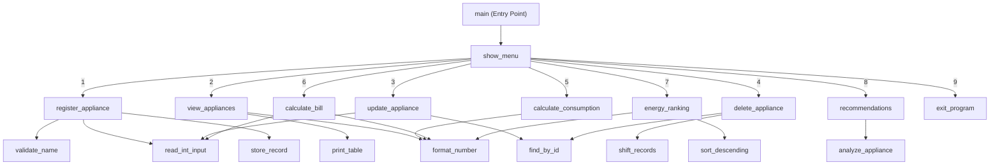
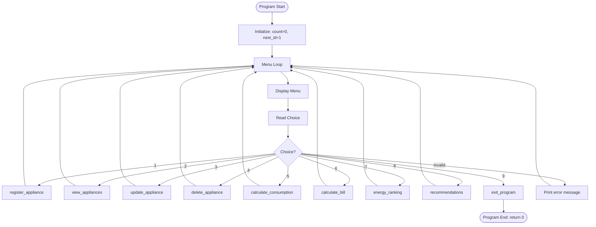

# WattWise — Phase 1: System Architecture

## 1. Project Overview

**WattWise** is a household electricity consumption tracker and analyzer written entirely in **NASM x86-64 Assembly Language** for Windows. It runs as a console application and provides nine menu-driven features for managing appliances, computing energy usage, estimating electricity bills, ranking appliances by consumption, and generating energy-saving recommendations.

All data is stored **in-memory only** — records do not persist after the program exits.

---

## 2. Development Environment

| Component | Detected Version / Path |
|---|---|
| **Operating System** | Windows (x86-64) |
| **Assembler** | NASM 3.01 (`nasm.exe` via MinGW-W64 WinLibs) |
| **C Compiler / Linker** | GCC 16.2.0 (MinGW-W64 x86_64-ucrt-posix-seh) |
| **GNU Linker** | GNU ld 2.47 (Binutils for MinGW-W64) |
| **Object Format** | `win64` (COFF64 / PE32+) |
| **Calling Convention** | Windows x64 (Microsoft ABI) |

### Why GCC as the linker driver?

Using `gcc` to link (rather than raw `ld` or GoLink) gives us:
- Automatic linkage of the C runtime startup (`mainCRTStartup` → `main`).
- Access to C library functions (`printf`, `scanf`, `puts`, `fgets`, `strlen`, etc.) without manually declaring every import.
- Automatic resolution of `kernel32.dll` and `msvcrt` symbols.
- Simpler build commands for a student project.

The assembly source defines a `main` symbol that GCC's startup code calls.

---

## 3. Target Architecture & Calling Convention

### 3.1 Windows x64 Calling Convention (Microsoft ABI)

| Rule | Detail |
|---|---|
| **Integer/pointer args** | RCX, RDX, R8, R9 (first four), then stack |
| **Float args** | XMM0–XMM3 (first four), then stack |
| **Return value** | RAX (integer/pointer), XMM0 (float) |
| **Caller-saved (volatile)** | RAX, RCX, RDX, R8, R9, R10, R11, XMM0–XMM5 |
| **Callee-saved (nonvolatile)** | RBX, RBP, RSI, RDI, R12–R15, XMM6–XMM15 |
| **Shadow space** | 32 bytes reserved by caller above the return address |
| **Stack alignment** | RSP must be 16-byte aligned **before** `CALL` |
| **Stack cleanup** | Caller cleans up arguments |

> [!IMPORTANT]
> Every `CALL` to a C library or Windows API function must have at least 32 bytes of shadow space allocated, and RSP must be 16-byte aligned at the point of the `CALL` instruction.

### 3.2 Register Usage Plan

| Register | WattWise Usage |
|---|---|
| RAX | Return values, arithmetic accumulator |
| RCX | 1st argument to C functions |
| RDX | 2nd argument to C functions |
| R8 | 3rd argument to C functions |
| R9 | 4th argument to C functions |
| RBX | Preserved — loop counters, base pointers into arrays |
| RSI | Preserved — source index for array traversal |
| RDI | Preserved — destination index / temp preserved value |
| RBP | Frame pointer (optional, used for stack frame clarity) |
| R12–R15 | Preserved — persistent values across C calls |
| RSP | Stack pointer — always aligned |

---

## 4. Application Features (Menu Options 1–9)

```
╔══════════════════════════════════════════════════╗
║          WattWise - Electricity Tracker          ║
╠══════════════════════════════════════════════════╣
║  [1] Register Appliance                         ║
║  [2] View All Appliances                        ║
║  [3] Update Appliance                           ║
║  [4] Delete Appliance                           ║
║  [5] Calculate Electricity Consumption           ║
║  [6] Calculate Electricity Bill                  ║
║  [7] Energy Consumption Ranking                  ║
║  [8] Energy Saving Recommendations               ║
║  [9] Exit                                        ║
╚══════════════════════════════════════════════════╝
```

| # | Feature | Description |
|---|---|---|
| 1 | **Register Appliance** | Add a new appliance with name, wattage (W), and daily operating hours. Auto-assigns a unique ID. |
| 2 | **View All Appliances** | Display all registered appliances in a formatted table. |
| 3 | **Update Appliance** | Modify an existing appliance's name, wattage, or hours by ID. |
| 4 | **Delete Appliance** | Remove an appliance by ID and shift remaining records to fill the gap. |
| 5 | **Calculate Consumption** | Compute daily kWh = (W × hours) / 1000 and monthly kWh = daily × 30 for all appliances. |
| 6 | **Calculate Bill** | Prompt for electricity rate (PHP/kWh), compute monthly cost = monthly kWh × rate. |
| 7 | **Energy Ranking** | Sort and display appliances by monthly consumption in descending order. |
| 8 | **Recommendations** | Analyze each appliance and suggest energy-saving actions for high-consumption or long-running devices. |
| 9 | **Exit** | Terminate the program gracefully. |

---

## 5. Data Architecture

### 5.1 Appliance Record Structure

Each appliance is stored as a **fixed-size record** in a contiguous array in the `.bss` section.

```
┌─────────────────────────────────────────────────────────────┐
│                    Appliance Record (72 bytes)               │
├──────────┬──────────┬──────────┬──────────┬─────────────────┤
│  ID      │  Name    │ Wattage  │  Hours   │  (padding)      │
│  8 bytes │ 32 bytes │  8 bytes │  8 bytes │  16 bytes       │
│  (QWORD) │ (string) │ (QWORD)  │ (QWORD)  │ (alignment)     │
└──────────┴──────────┴──────────┴──────────┴─────────────────┘
```

| Field | Offset | Size | Type | Description |
|---|---|---|---|---|
| `id` | 0 | 8 bytes | QWORD (uint64) | Auto-incremented unique ID |
| `name` | 8 | 32 bytes | Null-terminated ASCII string | Appliance name (max 31 chars + null) |
| `wattage` | 40 | 8 bytes | QWORD (uint64) | Power rating in watts (integer) |
| `hours` | 48 | 8 bytes | QWORD (uint64) | Daily operating hours (integer) |
| *(reserved)* | 56 | 16 bytes | — | Padding for 8-byte alignment & future use |

**Record size: 72 bytes** (aligns nicely for indexing: `record_addr = base + index * 72`)

> [!NOTE]
> Wattage and hours are stored as integers. Calculations use **fixed-point arithmetic** (multiply by scaling factor, then format with decimal point on output) to display kWh and PHP values with 2 decimal places.

### 5.2 Storage Constants

| Constant | Value | Purpose |
|---|---|---|
| `MAX_APPLIANCES` | 20 | Maximum number of appliance records |
| `RECORD_SIZE` | 72 | Size of one appliance record in bytes |
| `NAME_SIZE` | 32 | Maximum bytes for appliance name (including null) |
| `INPUT_BUF_SIZE` | 64 | General-purpose input buffer size |

### 5.3 Global Variables (`.bss` and `.data`)

```nasm
section .data
    next_id         dq  1          ; Next ID to assign (auto-increment)
    appliance_count dq  0          ; Current number of registered appliances

section .bss
    appliances      resb 72 * 20   ; Array: 20 records × 72 bytes = 1440 bytes
    input_buffer    resb 64        ; General input buffer
    name_buffer     resb 32        ; Name input buffer
```

### 5.4 Fixed-Point Arithmetic Strategy

Since we avoid floating-point instructions for simplicity (keeping the code accessible to Assembly Language students), all energy calculations use **integer arithmetic with a scale factor of 100** to represent 2 decimal places.

| Calculation | Formula | Integer Implementation |
|---|---|---|
| Daily kWh | (W × H) / 1000 | `(W * H * 100) / 1000` → result in hundredths of kWh |
| Monthly kWh | Daily × 30 | `daily_hundredths * 30` |
| Monthly Bill | Monthly kWh × Rate | `(monthly_hundredths * rate_hundredths) / 100` |

**Display**: The integer result is divided by 100 for the whole part and `mod 100` for the decimal part, then formatted as `XX.YY`.

**Example**: Electric Fan, 75W, 8 hours
- Daily: `(75 * 8 * 100) / 1000 = 60` → 0.60 kWh ✓
- Monthly: `60 * 30 = 1800` → 18.00 kWh ✓
- Bill at ₱12.00/kWh: Rate = 1200 (hundredths). `(1800 * 1200) / 100 = 21600` → ₱216.00 ✓

---

## 6. Module / Procedure Architecture

The program is organized into **logical groups of procedures**, all within a single `.asm` source file (keeping the build simple for a student project).

### 6.1 Procedure Map



### 6.2 Procedure Inventory

| Procedure | Purpose | Called By |
|---|---|---|
| `main` | Entry point. Pushes preserved registers, enters menu loop. | CRT startup |
| `show_menu` | Prints the main menu, reads user choice. | `main` |
| `register_appliance` | Prompts for name/wattage/hours, validates, stores record. | Menu option 1 |
| `view_appliances` | Iterates appliance array, prints formatted table. | Menu option 2 |
| `update_appliance` | Finds record by ID, prompts for new values, updates in-place. | Menu option 3 |
| `delete_appliance` | Finds record by ID, shifts subsequent records up, decrements count. | Menu option 4 |
| `calculate_consumption` | Computes daily & monthly kWh for all appliances, displays results. | Menu option 5 |
| `calculate_bill` | Prompts for rate, computes monthly cost per appliance & total. | Menu option 6 |
| `energy_ranking` | Copies consumption data, sorts descending, displays ranked list. | Menu option 7 |
| `recommendations` | Checks each appliance against thresholds, prints suggestions. | Menu option 8 |
| `exit_program` | Prints goodbye message, returns 0 from `main`. | Menu option 9 |
| `read_int_input` | Reads a line, converts ASCII to integer with validation. | Multiple |
| `find_by_id` | Linear search through array for matching ID. Returns pointer or 0. | `update`, `delete` |
| `shift_records` | Moves records to fill gap after deletion. | `delete_appliance` |
| `sort_descending` | Selection sort on a temporary index array by consumption value. | `energy_ranking` |
| `format_number` | Converts integer (hundredths) to `"XX.YY"` string for display. | Multiple |
| `print_table_header` | Prints column headers with separators. | `view`, `calc`, `bill`, `rank` |
| `print_separator` | Prints a horizontal line of dashes. | Multiple |
| `clear_input_buffer` | Flushes leftover characters from stdin. | After `scanf` calls |

---

## 7. Program Control Flow



---

## 8. Memory Layout Overview

```
┌──────────────────────────────────────────────────┐
│                  .data section                    │
│  String literals (menus, prompts, format strings) │
│  next_id (QWORD)                                  │
│  appliance_count (QWORD)                          │
└──────────────────────────────────────────────────┘
┌──────────────────────────────────────────────────┐
│                  .bss section                     │
│  appliances[0..19] — 1440 bytes (20 × 72)        │
│  input_buffer — 64 bytes                          │
│  name_buffer — 32 bytes                           │
│  sort_indices[0..19] — 160 bytes (20 × 8)        │
│  sort_values[0..19] — 160 bytes (20 × 8)         │
│  format_buffer — 32 bytes                         │
└──────────────────────────────────────────────────┘
┌──────────────────────────────────────────────────┐
│                  Stack (at runtime)               │
│  Shadow space (32 bytes)                          │
│  Local variables                                  │
│  Preserved registers (RBX, RSI, RDI, R12–R15)    │
│  Return addresses                                 │
└──────────────────────────────────────────────────┘
```

---

## 9. External Functions Used

All external functions are from the C standard library, accessed via GCC linkage:

| C Function | Used For | NASM Declaration |
|---|---|---|
| `printf` | Formatted output (menus, tables, results) | `extern printf` |
| `scanf` | Reading integer input | `extern scanf` |
| `fgets` | Reading string input (appliance names) | `extern fgets` |
| `stdin` | File handle for `fgets` | `extern __iob_func` or `extern __acrt_iob_func` |
| `puts` | Simple line output | `extern puts` |
| `strlen` | Measuring string length (to strip newline) | `extern strlen` |
| `strcpy` | Copying strings between buffers | `extern strcpy` |
| `memcpy` | Copying record blocks during shift/sort | `extern memcpy` |
| `exit` | Program termination (fallback) | `extern exit` |

> [!NOTE]
> With MinGW-W64 (UCRT), `stdin` is accessed via `__acrt_iob_func(0)`. This returns a pointer to the `FILE*` for standard input, needed by `fgets`.

---

## 10. Build Process

### 10.1 Assembly & Link Commands

```batch
@echo off
REM build.bat — Assemble and link WattWise
nasm -f win64 -o wattwise.obj wattwise.asm
if errorlevel 1 (
    echo [ERROR] Assembly failed.
    pause
    exit /b 1
)
gcc -o wattwise.exe wattwise.obj -lkernel32 -lmsvcrt
if errorlevel 1 (
    echo [ERROR] Linking failed.
    pause
    exit /b 1
)
echo [SUCCESS] Build complete: wattwise.exe
pause
```

### 10.2 Build Steps Explained

| Step | Command | What It Does |
|---|---|---|
| Assemble | `nasm -f win64 -o wattwise.obj wattwise.asm` | Assembles NASM source into a Win64 COFF object file |
| Link | `gcc -o wattwise.exe wattwise.obj` | Links the object with C runtime, resolves `printf`/`scanf`/etc., produces executable |

---

## 11. Online Compiler Considerations

For an **online version** (e.g., targeting Linux x86-64 on platforms like JDoodle, Compiler Explorer, or TutorialsPoint):

| Aspect | Windows Version | Online (Linux) Version |
|---|---|---|
| Object format | `win64` | `elf64` |
| Calling convention | Microsoft x64 ABI | System V AMD64 ABI |
| First 4 int args | RCX, RDX, R8, R9 | RDI, RSI, RDX, RCX |
| Shadow space | 32 bytes required | Not required |
| Entry point | `main` (via GCC) | `main` (via GCC) or `_start` |
| C library | UCRT / msvcrt | glibc |
| Linker | `gcc` (MinGW) | `gcc` (native) |
| stdin access | `__acrt_iob_func` | `stdin` symbol (extern) |

> [!WARNING]
> The online version requires a **separate `.asm` file** with different calling conventions. The logic and algorithms remain the same, but every C function call site must use System V ABI registers.

---

## 12. Recommendation Engine Thresholds

| Condition | Threshold | Recommendation |
|---|---|---|
| High wattage | > 1000 W | "Consider replacing with an energy-efficient model." |
| Very long daily use | > 12 hours/day | "Reduce operating hours or use a timer." |
| High monthly consumption | > 100 kWh/month | "This appliance is a major electricity consumer. Monitor usage." |
| Moderate consumption | 50–100 kWh/month | "Usage is moderate. Consider off-peak operation." |
| Low consumption | < 50 kWh/month | "Consumption is within efficient range." |

---

## 13. Input Validation Rules

| Input | Valid Range | Error Handling |
|---|---|---|
| Appliance name | 1–31 non-empty ASCII characters | Reject empty names, truncate at 31 chars |
| Wattage | 1–100,000 W (integer) | Reject 0, negative, non-numeric |
| Operating hours | 1–24 (integer) | Reject 0, > 24, non-numeric |
| Menu choice | 1–9 (integer) | Print "Invalid choice" and re-display menu |
| Electricity rate | 1–10,000 (in centavos, i.e., 100–1,000,000 input as pesos with 2 decimals) | Reject 0 and non-numeric |
| Appliance ID | Must exist in array | Print "Appliance not found" |

---

## 14. Final Project Folder Structure

```
WattWise/
├── windows/
│   ├── wattwise.asm          # Main NASM source (Windows x64)
│   └── build.bat             # Build script
├── online/
│   └── wattwise.asm          # Linux x86-64 version for online compilers
├── documentation/
│   ├── CODE_EXPLANATION.md   # Technical + beginner-friendly code docs
│   ├── TEST_REPORT.md        # Testing results and verification
│   └── system-architecture.md # This document
└── README.md                 # Setup, compilation, and usage guide
```

---

## 15. Phase Summary & Next Steps

### ✅ Phase 1 Complete — System Architecture Defined

| Decision | Choice | Rationale |
|---|---|---|
| Assembler | NASM 3.01 | Available on system, standard for educational x86-64 |
| Object format | `win64` (COFF64) | Required for Windows x64 targets |
| Linker | GCC (MinGW-W64) | Simplifies C library access, available on system |
| Calling convention | Microsoft x64 ABI | Required for Windows |
| Data storage | In-memory array, 72-byte records | Simple, no file I/O complexity |
| Arithmetic | Integer with ×100 scale factor | Avoids FPU/SSE complexity; suitable for students |
| I/O | C library (`printf`, `scanf`, `fgets`) | Easier string formatting than raw Win32 API |
| Max records | 20 | Sufficient for demonstration; avoids dynamic allocation |

### Next Phase: Implementation

**Phase 2** will implement the complete NASM source code following this architecture:

1. Data section declarations (strings, variables)
2. BSS section (arrays, buffers)
3. `main` and `show_menu`
4. `register_appliance` with input validation
5. `view_appliances` with table formatting
6. `update_appliance` and `delete_appliance`
7. `calculate_consumption` and `calculate_bill`
8. `energy_ranking` with sorting
9. `recommendations` with threshold logic
10. Utility procedures (`read_int_input`, `find_by_id`, `format_number`, etc.)

> [!TIP]
> **To proceed to Phase 2 (Implementation), reply with "Continue" or "Proceed to Phase 2".**
